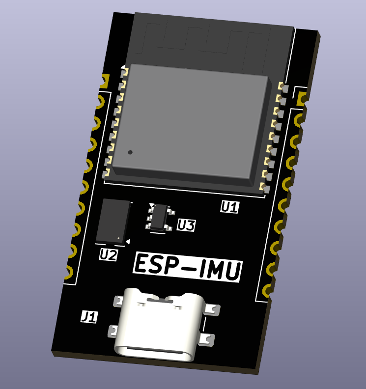

# Introduction

A project for a devboard which will also be used for the RobotArm 
The devboard includes the IMUs we got with the LCD box and a ESP (like esp32 c3). 
USB-C and a DNP FLASH IC. 
If room add GPIO 2.54mm header.

